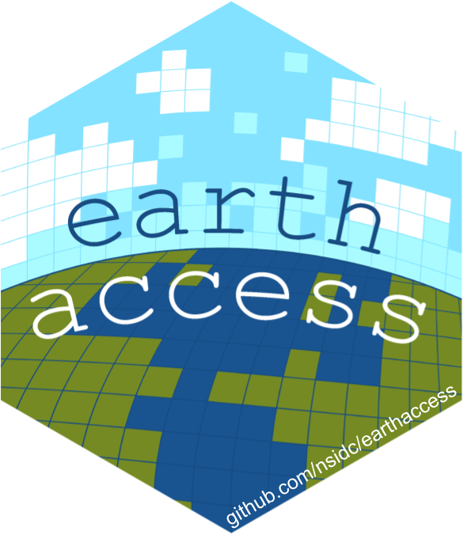

------------------------------------------------------------------------

# **earthaccess hackathon \@ AGU 2026**

{fig-alt="hexagonal earthaccess logo, an illustrated earth as pixels with blue text arcing across" fig-align="left" width="100"} 

Are you attending AGU and are a research scientist or student who is curious about agentic workflows and ready to get hands-on? We are hosting a 3-hour hackathon on Wednesday, **December 9, from 3:30 to 6:30 PM**, and we are looking for participants who want to explore how agents can tackle real Earth science problems. This is not a lecture, it will be a fun working session where you will spend the afternoon hacking alongside peers. We will provide cloud credits so you can use the LLM of your choice, with agent support limited to **Pi, ChatGPT Codex, Claude Code, OpenCode, and Jupyter AI**.

To make the most of our time together, we ask that you come prepared on two fronts. First, you should already be familiar with agents such as ChatGPT or Claude; you do not need to be an expert, but you should have used them enough to know how they work and where they might help your research. Second, you should have specific **NASA datasets** in mind that you want to work with. Even better if you have a new kind of question that this data could help answer. The goal is not just general curiosity or isolated experimentation. We want to improve the APIs and tooling that serve NASA data so that humans can get to their science faster and more efficiently when using agentic workflows.

This hackday is co-located with AGU and will take place in a rooftop venue with dedicated spaces for coworking, conversations, and open views of the Bay. If you are ready to spend three hours exploring the intersection of agents and Earth science, we would love to have you. Please fill out the registration form below so we can tailor the session to the interests and datasets of the group.

## Event details

**When: Wednesday, 9 December 2026, 3:30-6:30 PM \@ CodeRabbit HQ**

**Where: 201 Spear St Ste 1700, San Francisco**

**Register by November 30, end of day in your time zone**: [Google Form](https://forms.gle/HaNSYZ1jdZEZHnnU8)\

## Requirements

-   Familiarity with coding agents e.g. chatgpt, claude

-   Using a NASA Earth dataset(s)

-   Github account

-   NASA Earthdata Login account

## Organizers

This event is organized by earthaccess, NASA Openscapes and StratusGeo. We are hosted by CodeRabbit AI and supported by NASA's Earth Science Data Systems (ESDS) program through its FY26 SI Innovation Call for Ideas. Mention of products does not imply NASA endorsement.

